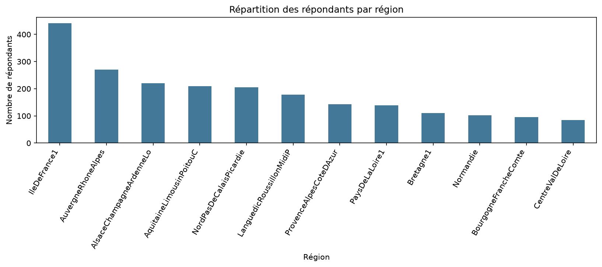
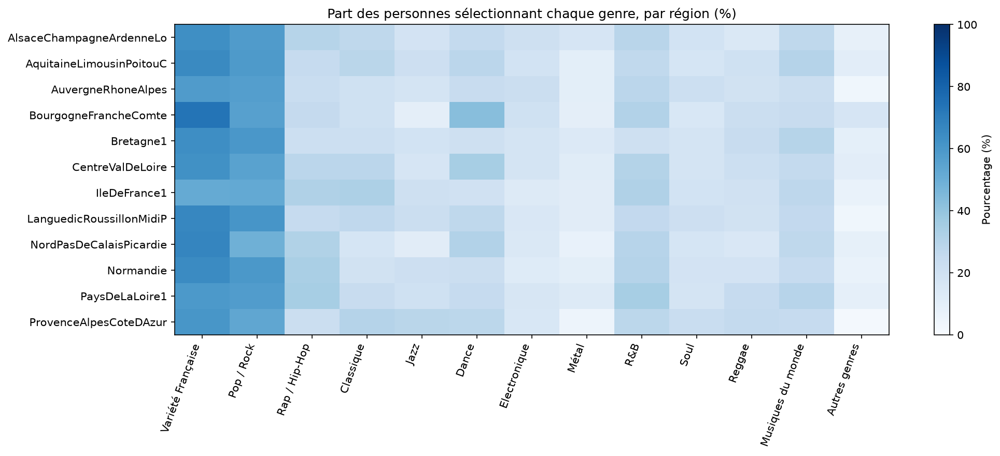
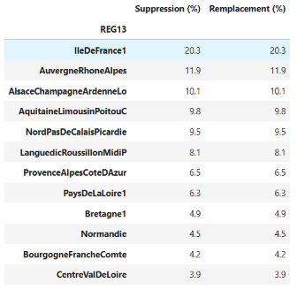

# Prédire la région d'un individu à partir de ses goûts musicaux

Projet Data Science – Télécom Paris, Kit Data Science
Groupe : Sara, Philippe, Mihary, Eleonore

---

## 1. La problématique

Est-ce qu'on peut deviner dans quelle région française vit quelqu'un juste en sachant quels genres de musique il écoute ?

C'est une question de classification. La variable à prédire (la cible) est la **région**. Les variables explicatives sont les **préférences musicales** déclarées par chaque personne.

---

## 2. Les données

### Source

Nous utilisons l'enquête **HADOPI 2020** sur les pratiques musicales des Français.

- Lien vers les données : `https://www.data.gouv.fr/datasets/pratiques-decoute-de-musique-en-ligne-2020`
- Les fichiers bruts sont rangés dans `Dataset/` (`hadopi-2020-musique-data.csv`, `.ods`)
- Un descriptif des jeux de données est disponible dans `documentation/datasets.md` 

Les données ont été téléchargées directement depuis le site. Il n'y a donc pas de script de collecte.

### Ce qu'on a gardé

Après nettoyage, le jeu de données final (`Dataset/dataset_musique_region.csv`) contient :

| Élément | Valeur |
|---|---|
| Personnes | 1 986 |
| Variables explicatives | 13 genres musicaux |
| Variable à prédire | 12 régions |
| Codage des genres | 0 = non sélectionné, 1 = sélectionné |

Les 13 genres : Variété française, Pop/Rock, Rap/Hip-Hop, Classique, Jazz, Dance, Électronique, Métal, R&B, Soul, Reggae, Musiques du monde, Autres genres.

---

## 3. Organisation du dépôt

```text
data-science-project/
├── Dataset/
│   ├── hadopi-2020-musique-data.ods
│   ├── dataset_musique_region.csv
│   └── dataset_musique_region_transforme.csv
├── documentation/
│   └── datasets.md
├── notebooks/
│   ├── exploration.ipynb
│   ├── nettoyage.ipynb
│   ├── transformation.ipynb
│   └── training_eval.ipynb
├── requirements.txt
└── README.md
```

---

## 4. Processus expérimental

On a suivi quatre étapes, dans cet ordre.

### Étape 1 – Explorer la donnée (`exploration.ipynb`)

L'idée : comprendre ce qu'on a entre les mains avant de toucher à quoi que ce soit.

Ce qu'on a regardé :

- les colonnes, les valeurs manquantes et les doublons ;
- la répartition des personnes selon les régions ;
- les genres musicaux les plus écoutés ;
- les différences de goûts musicaux entre les régions.

**Répartition des répondants par région**



On voit tout de suite, qu'il y a un déséquilibre. L'Île-de-France compte environ 440 réponses, alors que le Centre-Val de Loire en a moins de 100. Ce point compte pour la suite : car un modèle peut avoir tendance à prédire « Île-de-France » par défaut.

**Part des personnes qui écoutent chaque genre, par région**



C'est le graphique le plus interessant. Les couleurs sont presque identiques d'une ligne à l'autre. La Variété française et la Pop/Rock dominent partout, le Métal et les « Autres genres » sont faibles partout. Autrement dit, **les goûts musicaux se ressemblent beaucoup d'une région à l'autre**. Ça annonce déjà que la prédiction sera difficile.

### Étape 2 – Nettoyer (`nettoyage.ipynb`)

Le jeu fait environ 2 200 lignes, donc **pandas** suffit largement.

Ce qu'on a fait :

- garder les 13 genres musicaux et la région ;
- les doublons et les réponses manquantes ;
- suppression et le remplacement des valeurs manquantes ;
- retirer les personnes sans profil musical exploitable ;
- coder les genres en 0 et 1 ;
- renommer les colonnes et vérifions les données.


**Valeurs manquantes : suppression ou remplacement ?**

On a testé les deux méthodes.

Choix retenu : **suppression** des lignes incomplètes. Les deux méthodes donnaient le même nombre de lignes au final (1 986), donc la suppression était la plus simple et n'introduisait pas de valeurs inventées.



### Étape 3 – Transformer (`transformation.ipynb`)

Nous créons deux nouvelles façons de regrouper les régions :

- **Encodage des genres** : chaque genre devient une colonne binaire (0/1)
- **Encodage de la région** : la région est transformée en étiquette numérique pour les modèles
- `[normalisation]`

Le fichier final est exporté dans `Dataset/dataset_musique_region.csv`.

### Étape 4 – Prédiction & Entraînement  
Nous comparons plusieurs méthodes :

- **Random Forest** : sur les 12 régions et sur les 7 groupes ;
- **K-Means** : pour rechercher des profils musicaux, puis les comparer aux régions ;
- **Régression logistique** : sur les 7 groupes ;
- **Deep Learning** : deux réseaux de neurones, l'un sur les 12 régions et l'autre sur les 7 groupes.

Nous utilisons une séparation **80 % entraînement / 20 % test** avec `random_state=42`. Les réseaux de neurones reprennent les mêmes personnes en entraînement et en test que les modèles classiques pour la cible correspondante.

Pour évaluer les résultats, nous utilisons :

- **Accuracy** : proportion de bonnes prédictions ;
- **F1 macro** : score qui donne la même importance à chaque région ou groupe ;
- **Matrices de confusion** : pour visualiser les erreurs ;
- **ARI et NMI** : pour comparer les groupes de K-Means aux régions.


---

## 5. Résultats

Résultats enregistrés dans `training_eval.ipynb` :

| Modèle | Accuracy | F1 macro |
|---|---:|---:|
| Random Forest – 12 régions | 19,1 % | 0,051 |
| Random Forest – 7 groupes | **24,9 %** | 0,148 |
| K-Means – 12 régions | 21,4 % | 0,029 |
| Régression logistique – 7 groupes | 23,9 % | 0,148 |
| Deep Learning – 12 régions | 9,3 % | 0,077 |
| Deep Learning – 7 groupes | 19,8 % | **0,182** |


**Ce qu'on en retient** `Nous avons clairement pas assez de données pour pouvoir répondre à notre problématique initiale.`

---

## 6. Difficultés rencontrées

- **Régions déséquilibrées** : certaines régions sont beaucoup plus représentées que d'autres.
- **Goûts musicaux proches** : les différences entre régions sont faibles.
- **Informations limitées** : nous utilisons seulement 13 genres musicaux binaires pour prédire la localisation.
- **Comparaison des modèles** : les résultats à 12 régions et à 7 groupes ne sont pas directement comparables.
- **Travail en groupe** : il faut maintenir les notebooks et les fichiers à jour sur Git.

---

## 7. Conclusion

Nous avons testé plusieurs modèles pour prédire la région d'une personne grâce à ses goûts musicaux.

Les résultats sont assez faibles. Le Random Forest obtient la meilleure accuracy et le Deep Learning le meilleur F1 macro pour les 7 groupes.

**Les goûts musicaux seuls ne suffisent donc pas pour prédire facilement la région d'une personne.**

**Pistes d'amélioration**

Pour améliorer les résultats, nous pourrions ajouter d'autres informations, comme l'âge ou la fréquence d'écoute, et mieux gérer les différences entre les régions.

---

## 8. Lancer le projet

Cloner le dépôt :

```bash
git clone https://github.com/felipemarzin-oss/data-science-project.git
cd data-science-project
```

Créer un environnement Python et installer les dépendances :

```bash
conda create -n musique python=3.11 -y
conda activate musique
python -m pip install -r requirements.txt
```

Ouvrir les notebooks dans cet ordre :

1. `exploration.ipynb`
2. `nettoyage.ipynb`
3. `transformation.ipynb`
4. `training_eval.ipynb`

